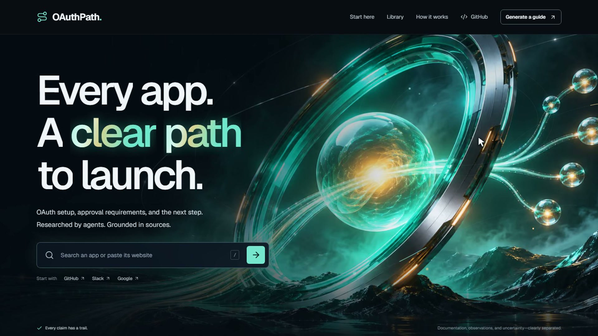
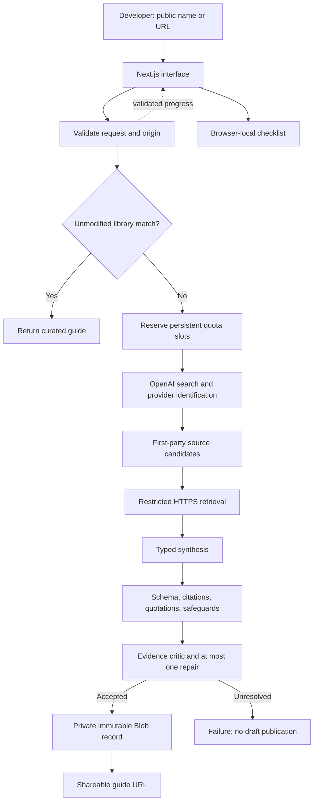

# OAuthPath

**Know the work, the wait, and the next step before launching an integration.**

[Working app](https://oauthpath-drab.vercel.app) · [Source](https://github.com/9059Rohith/oauthpath) · [Watch the 2:05 demo](https://oauthpath-drab.vercel.app/demo/oauthpath-demo.mp4) · [Submission walkthrough](docs/SUBMISSION.md)

OAuthPath helps developers decide whether they need their own provider OAuth app, follow an evidence-linked setup guide, and research an unfamiliar app live. It distinguishes app registration, provider review, Marketplace listing, organization approval, and each user's consent.

## Five-minute reviewer walkthrough

1. [Choose managed or custom OAuth](https://oauthpath-drab.vercel.app/start). Availability is checked in the official directory, never assumed here.
2. Compare [GitHub](https://oauthpath-drab.vercel.app/guide/github), [Google / Gmail](https://oauthpath-drab.vercel.app/guide/google), and [LinkedIn](https://oauthpath-drab.vercel.app/guide/linkedin): app-model choice, sensitive data, and gated access.
3. Check a step, reload, continue to the next unfinished task, and copy a handoff with technical decisions, blockers, uncertainties, and sources. Export Markdown or print a guide.
4. [Generate a guide](https://oauthpath-drab.vercel.app/generate) for an unfamiliar name or public documentation URL. Optionally specify internal/pilot/public users and the capability you need. Watch real research, then open and share the saved URL.
5. Inspect live research examples and a reviewed revision: [Linear](https://oauthpath-drab.vercel.app/guide/linear-e0fc5709ccf7), [Dropbox](https://oauthpath-drab.vercel.app/guide/dropbox-f2693009770b), [Asana from the demo](https://oauthpath-drab.vercel.app/guide/asana-7aa2432c6752), [reviewed Miro](https://oauthpath-drab.vercel.app/guide/miro-reviewed-ea26bc366b64).

## Run locally

Requires Node.js 24 and npm. The library and interface work without credentials.

```sh
npm ci
cp .env.example .env.local
npm run dev
```

For live AI research, set server-only `OPENAI_API_KEY`. Durable generated guides and quotas require a private Vercel Blob store and `BLOB_READ_WRITE_TOKEN`. Optional model names and site URL are documented in `.env.example`. Never prefix credentials with `NEXT_PUBLIC_`, commit `.env.local`, or enter tokens into the research form. To use an existing authorized Vercel project, `vercel link` and `vercel env pull .env.local` retrieve its configuration.

```sh
npm run verify
npx playwright install chromium
npm run test:e2e
npm run build
npm audit --omit=dev
```

Deploy this Next.js project to Vercel with the same server environment variables. GitHub Pages cannot execute its research API or private storage operations.

## Key decisions

- **Focused content:** eight varied researched providers, 52 authored steps and 29 source entries. The brief permits a sample; 100 authored guides are not claimed. A validated schema and generated compact catalog support expansion.
- **Evidence before confidence:** direct OpenAI web search → provenance-checked first-party documents → bounded DNS-pinned retrieval → typed synthesis → quotation/citation checks → skeptical review → one repair attempt → immutable private storage. Supplied URLs must match confirmed provider ownership. Failed drafts are not published.
- **Launch coverage:** a separate policy search runs when setup sources lack distribution guidance. Maintained entry points and fresh-source-dependent safeguards address difficult provider policies. OAuth protocol, user audience and requested capability affect the guide.
- **Useful next action:** local progress advances the checklist, opens the right task, and produces a shareable handoff. Checking a box never claims provider approval.
- **Fast, accessible presentation:** server-rendered featured content, generated artwork, section-specific artwork, scroll-linked word animation, vertical hero parallax, pausable provider marquees, and reduced-motion support. No heavyweight animation runtime.

## Verification and limits

Verified November 3, 2026: **182 unit tests** and **33 production browser checks** passed. Latest mobile Lighthouse: **80 performance / 100 accessibility / 100 best practices / 100 SEO**, LCP 2.7s, TBT 580ms, CLS 0. Recent runs ranged from 77 to 93; these are lab observations, not a consistent performance pass or field guarantee. The fresh production dependency audit found zero known vulnerabilities. The actual Asana demo request completed in 18.502s. The Miro example is explicitly labeled as a source-reviewed derivative. See [the detailed evaluation](EVALUATION.md).

No authenticated provider app registration, token exchange, or completed approval is claimed. [Actual anonymous setup attempts](docs/SETUP_ATTEMPTS.md) record sign-in boundaries, an inaccessible console, and public OIDC metadata. [Corrections](docs/SEED_CORRECTIONS.md) explain what source review changed. Model prose still needs source inspection; citations and an AI critic do not establish universal accuracy.

Generated guides are unlisted and noindexed, but anyone with their link can read them. Research inputs must be public information. Progress stays in browser storage. Limits are five attempts/hour/network and thirty/day globally; interrupted work is not resumable. A document-only fallback is explicitly incomplete. No user accounts, provider-write tools, or deletion dashboard are included. Retention cleanup and broad accuracy evaluation remain future work.

Every Vercel build gates on lint and unit tests. The [GitHub Actions template](docs/ci-workflow.yml) is inactive because the publishing credential lacks workflow scope; no green Actions run is claimed.

[Security model](SECURITY.md) · [Decisions](DECISIONS.md) · [Assignment audit](docs/FINAL_REQUIREMENTS_AUDIT.md) · [Research notes](docs/RESEARCH.md) · [1,000-line build specification](docs/MASTER_BUILD_PROMPT.md)

## The problem and the product model

A developer wants an agent's users to connect a provider. Before the first legitimate customer connection, they may need to choose an app model, register credentials, select permissions, configure redirects, satisfy customer restrictions, and submit a review. A working development connection does not establish permission to launch publicly.

OAuthPath helps identify whether the next task is configuration, a customer administrator's decision, a partner application, or a provider review with an uncertain wait. The result is a self-contained guide another developer can follow and share. It is not a credential broker or autonomous provider-registration service.

| Concept             | Meaning                                             | Product treatment                                |
| ------------------- | --------------------------------------------------- | ------------------------------------------------ |
| Your integration    | Application/agent using provider capabilities       | Requested feature and audience guide research    |
| Provider OAuth app  | Registered identity, permissions, redirects, review | Setup and launch instructions                    |
| User connection     | One user's consent and resulting tokens             | Test guidance; no token collection or execution  |
| Customer approval   | Organization installation/data-access controls      | A separate administrator handoff                 |
| Marketplace listing | Provider discovery/distribution program             | Separate from basic installation where supported |

Managed OAuth may remove the registration work. Coverage depends on the toolkit and authentication method. The ownership chooser links to the official directory, states that availability has not been checked locally, and does not imply that managed registration bypasses consent.

## Demo recording and chapter map

**[Watch the actual application demo — 2 minutes 5 seconds](https://oauthpath-drab.vercel.app/demo/oauthpath-demo.mp4).** H.264 MP4, 1920 × 1080, 25 fps, approximately 22.9 MB. The silent recording shows only the web application, with a cursor/click indicator. There are no slides, terminal screens, mock responses or replayed research. Only blank lead-in and idle tail footage were trimmed; playback remains at normal speed.

[](https://oauthpath-drab.vercel.app/demo/oauthpath-demo.mp4)

| Time | Actual interaction                                     | Evidence                                                               |
| ---- | ------------------------------------------------------ | ---------------------------------------------------------------------- |
| 0:00 | Homepage and scroll                                    | Glowing type, vertical parallax, section art, provider marquee         |
| 0:20 | Managed/custom ownership                               | Determine whether a provider registration is needed                    |
| 0:27 | Filter the library                                     | Find a researched provider                                             |
| 0:34 | GitHub guide, checklist, handoff and export            | Next task advances; sources travel with the work                       |
| 0:53 | Google / Gmail guide                                   | Compare effort, provider waiting and verification                      |
| 1:01 | Submit Asana, public audience, task-reading capability | One genuine model-backed research request outside the library          |
| 1:23 | Open the newly saved guide                             | Actual generation completed in 18.502 seconds                          |
| 1:39 | Inspect evidence and uncertainty                       | Four actual HTTP observations, conflicting policies and human handoffs |
| 1:51 | Share the saved result                                 | Reopenable guide URL and launch overview                               |

The Asana segment is fresh generation, not a previously saved guide substituted for research. The GitHub/Gmail segments use the authored library. No provider registration, consent, token exchange or approval is shown or claimed. Recording provenance, reproduction instructions and editing boundaries are in [the demo notes](docs/DEMO.md). The homepage subsequently received the viewport-only sizing fix; the recorded research and guide behavior are unchanged.

## Capabilities and provider coverage

Search and filter eight researched guides. Cards summarize complexity/effort; full guides state their scenario and sources. Featured cards are server-rendered, while the interactive library uses a generated compact catalog.

The generator accepts a provider name or public HTTPS website/documentation URL. Choose internal users, a limited pilot, or public external access, and optionally describe the feature. Discovery distinguishes OAuth 2, OAuth 1, unknown authentication, and no confirmed OAuth support rather than inventing authorization-code instructions for every service.

Every task includes instructions, ownership, completion criteria, source references, and recovery guidance. Checking a task advances the next-action card. Browser-local progress survives reloads and supports reset; it does not synchronize across users/devices or change provider approval.

Handoffs include remaining work, owners, technical decisions, human responsibilities, blockers, unknowns, and sources. Markdown exports carry approval information, research mode, source dates, HTTP observations, and agent/human boundaries. Browser print supports PDF sharing without a separate PDF-generation service.

The library contains **52 authored steps and 29 source entries**. Those are content counts, not completed actions or independent accuracy measurements.

| Provider       | Representative setup distinction                                       |
| -------------- | ---------------------------------------------------------------------- |
| GitHub         | Explicit OAuth App path; separate GitHub App alternative               |
| Google / Gmail | Scope classification, test audience, verification, possible assessment |
| Slack          | Workspace OAuth, bot/user permissions, commercial distribution         |
| Notion         | Cross-workspace installation and optional listing                      |
| LinkedIn       | Product/API access can gate useful integration work                    |
| Zoom           | App model and audience affect setup/publishing                         |
| Shopify        | Distribution choice changes merchant audience and review               |
| Atlassian      | Consent, permissions, API access, distribution                         |

Provider policy can change. The linked scenario and source documents are the operative context; complexity is editorial, not a provider certification.

## Reading a guide correctly

| Section              | Meaning                                               |
| -------------------- | ----------------------------------------------------- |
| Scenario             | Assumed audience, app model and capability            |
| Complexity           | Setup assessment independent of review duration       |
| Hands-on work        | Planning estimate with assumptions                    |
| Waiting              | Sourced information or explicit uncertainty           |
| Approval route       | Provider/distribution/customer permission boundaries  |
| Requirements         | Documented, inferred, or unknown status               |
| Launch path          | Ordered tasks, owners, completion/recovery conditions |
| Blockers             | Recognizable problem with a next action               |
| Technical details    | Supported endpoints, scopes and configuration         |
| Agent + you          | Preparation versus account-bound human work           |
| Observations/sources | Dated retrieval evidence and provider documents       |

A document fetch does not prove OAuth works. A checked task is the user's own progress statement. Neither establishes registered credentials, a successful token exchange, or provider approval.

## Architecture and research lifecycle



| Layer          | Implementation                                               |
| -------------- | ------------------------------------------------------------ |
| Application    | Next.js App Router, React, TypeScript                        |
| Research       | Node route; direct OpenAI Responses API through the AI SDK   |
| Guide contract | Zod schema and citation integrity validation                 |
| Retrieval      | Restricted public HTTPS client and Cheerio cleanup           |
| Persistence    | Private Vercel Blob: immutable guides and quota reservations |
| Progress       | Server-sent events with a bounded validated decoder          |
| Local state    | React and browser storage                                    |
| Validation     | Vitest, Playwright, axe, TypeScript, ESLint                  |
| Delivery       | Vercel application and GitHub source                         |

Exact dependencies are recorded in package.json/package-lock.json. The deployed application does not require a separate queue worker, database server, or browser automation process.

### 1. Validate and choose the route

The API checks bounded JSON, query length, audience, capability, and origin. Website inputs reject unsafe schemes, credentials in URLs, IP literals, private destinations, and unsupported syntax.

An unchanged known-provider query can return its seed immediately. A changed audience, capability, or explicit refresh invokes research. This is a curated-library shortcut, not a general cache of all generated guides.

### 2. Discover provider-owned evidence

Direct OpenAI web search identifies the provider and candidate sources. Search-derived URLs need recorded provenance and must match the provider's documentation domain or an explicit approved relationship. Third-party tutorials are not relabeled as provider evidence.

Maintained entry points complement discovery for difficult policies. They are fetched afresh and identified as candidates, not automatically trusted facts. If setup sources lack a launch path, a separate bounded search looks for distribution/review requirements. A failed source contributes an observation, not an inferred policy.

### 3. Retrieve public documents

The fetcher checks DNS answers, pins connections to allowed public addresses, validates redirects, bounds response size, and applies deadlines. Scripts and common hidden/navigation content are removed before synthesis.

No browser cookies, logged-in sessions, authorization headers, or provider secrets accompany these requests. Dynamic-only pages, blocked requests, and incomplete responses remain possible investigation limits.

### 4. Synthesize, validate, and review

Typed output must satisfy the guide schema. Citation IDs must exist, actionable sections require sources, and supporting quotations must match retrieved text within quotation limits.

Source-conditioned safeguards address errors found in actual review: production thresholds, external installation, optional Marketplace routes, REST versus embedded UI configuration, and customer policies. Positive corrections require supporting fresh evidence. Missing evidence becomes uncertainty or a verification task.

A separate critic checks material unsupported claims and missing launch requirements. One repair is allowed; an unresolved draft is not published. **The critic is not an accuracy oracle.** Valid JSON, a real citation, and a matching quotation can still accompany an incorrect inference. Conflicting provider documents need explicit qualification and source review, not an unsupported choice of the more convenient rule.

### 5. Save before reporting completion

Accepted guides are validated again and stored as private immutable JSON. Completion is emitted only after saving succeeds. Readers open an application URL, never a storage credential.

Reviewed corrections create new records. Known inaccurate demonstration URLs can redirect to reviewed replacements while original stored snapshots remain intact. Derivatives disclose their origin and preserve original AI timing as provenance rather than presenting editorial work as another model run.

### Incomplete document-scan mode

Certain model credential/availability failures permit a public-document scan. It gathers source material and investigation tasks; it does not invent missing approval rules, scopes, or endpoints. The mode is visibly labeled `document-scan`.

Fallback still needs working storage and quotas. It does not enable fresh durable generation on a completely unconfigured local installation, and not every model failure produces fallback.

## Practical investigation and corrections

[SETUP_ATTEMPTS.md](docs/SETUP_ATTEMPTS.md) records repeatable anonymous requests with timestamps and bounded observations.

| Attempt                   | Observed outcome                  | Not established                                         |
| ------------------------- | --------------------------------- | ------------------------------------------------------- |
| GitHub registration entry | Sign-in redirect, HTTP 200        | Authenticated submission/client creation                |
| Slack app management      | Page required sign-in             | Workspace selection, registration, installation         |
| Google OAuth console      | Incomplete-response failure twice | Console access or completed setup                       |
| Google OIDC discovery     | Public metadata parsed            | Client eligibility, consent, token exchange, API access |

Account ownership, credentials, consent, legal commitments, and submission remain human responsibilities. No authenticated provider registration or completed approval is claimed.

Investigation changed actual guidance:

- Google gained explicit client creation, callback registration, test-audience eligibility, state validation, code exchange, and a scoped test recipe.
- GitHub OAuth App instructions were separated from the alternative GitHub App model.
- Dropbox's threshold-triggered deadline was separated from review turnaround.
- Linear's external distribution was separated from private defaults and optional listing/native-agent features.
- Miro's direct sharing, Marketplace path, REST callback, embedded Web SDK URL, and customer-admin boundaries were corrected.

Miro's promoted example is visibly reviewed; blocked Help Center retrieval is recorded as unavailable. The correction history is part of the evidence, not concealed behind a blanket accuracy claim. Further source conflicts should be documented in [EVALUATION.md](EVALUATION.md) when verified rather than inferred from a passing model review.

## Security and data boundaries

Research accepts public inputs. Retrieved pages and model output are untrusted. Synthesis and review have no tools for provider-account writes, email, billing, credential creation, or end-user token access.

| Boundary          | Current protection                                      | Remaining limitation                                       |
| ----------------- | ------------------------------------------------------- | ---------------------------------------------------------- |
| Browser → server  | Bounded inputs, typed audience, origin check            | Public research inputs reach model services                |
| Server → provider | HTTPS, public DNS, pinned connection, checked redirects | Public sites can mislead or block requests                 |
| Source → model    | Cleaned text, untrusted-data policy, bounded tools      | Instructions alone cannot guarantee injection resistance   |
| Model → guide     | Schema, citations, quotes, critic, safeguards           | Structural validity does not prove factual entailment      |
| Server → storage  | Private access and immutable validated writes           | Share URLs are not authenticated workspaces                |
| Shared guide      | Random slug and noindex                                 | Anyone holding the URL can read it                         |
| Checklist         | Browser-local state                                     | No team/device synchronization                             |
| Resource use      | Persistent network/global quotas                        | Shared networks share limits; not a dollar-spend guarantee |

Fetched responses are capped at 750 KiB with at most three redirects. Generation has a 150-second application deadline within a route configured for up to 180 seconds. These are execution bounds, not expected latency or guaranteed completion.

Secrets belong in ignored environment files and hosting configuration. OAuthPath does not collect end-user provider tokens. CSP/security headers reduce exposure, but inline framework scripts/styles remain permitted; nonce-based strict CSP is not implemented. See [SECURITY.md](SECURITY.md).

## Detailed setup and environment

Use Node.js 24 and npm. Library reading needs no external credentials. Full live research needs OpenAI access and a private Vercel Blob store for results/quotas. Provider OAuth accounts are not required to evaluate guide reading.

```sh
git clone https://github.com/9059Rohith/oauthpath.git
cd oauthpath
npm ci
```

Create `.env.local` using `cp .env.example .env.local` on macOS/Linux, or PowerShell:

```powershell
Copy-Item .env.example .env.local
```

Set the local public origin to `http://127.0.0.1:3000`, add server credentials only when needed, and run `npm run dev`. Both development and production start scripts bind to `127.0.0.1` by default.

```sh
npm run build
npm start
```

The build regenerates the compact catalog, runs lint/unit tests, then builds Next.js. Author seeds in `content/seeds.json`; do not edit generated catalog entries by hand.

| Variable                 | Purpose                              | Needed for                                             |
| ------------------------ | ------------------------------------ | ------------------------------------------------------ |
| `OPENAI_API_KEY`         | Server-only Responses API credential | Full live research                                     |
| `BLOB_READ_WRITE_TOKEN`  | Private Blob reads/writes and quotas | New durable generation; storage failure stops research |
| `NEXT_PUBLIC_SITE_URL`   | Public application origin            | Correct local/deployment metadata                      |
| `OPENAI_RESEARCH_MODEL`  | Discovery; default `gpt-4.1-mini`    | Optional override                                      |
| `OPENAI_SYNTHESIS_MODEL` | Guide synthesis; default `gpt-4.1`   | Optional override                                      |
| `OPENAI_REVIEW_MODEL`    | Evidence critic; default `gpt-4.1`   | Optional override                                      |

Defaults describe this implementation, not universally newest/best models. Overrides need compatible Responses API, search, and structured-output support and should be revalidated. Never expose server credentials through `NEXT_PUBLIC_`, commit environment secrets, or show them in recordings.

## API and streaming contract

`POST /api/generate` accepts JSON:

```json
{
  "query": "Miro",
  "audience": "public",
  "capability": "Read board items for an AI assistant",
  "refresh": true
}
```

| Field        | Contract                                                      |
| ------------ | ------------------------------------------------------------- |
| `query`      | Required plain text, 2–180 characters; name or public website |
| `audience`   | `public`, `pilot`, or `internal`; default `public`            |
| `capability` | Optional public feature description, at most 240 characters   |
| `refresh`    | Optional boolean bypassing the seed shortcut                  |

An unmodified known-provider request returns JSON such as `{"slug":"github","cached":true}`. Research returns SSE progress, heartbeat, completion, or error. Completion identifies the saved slug/mode. The decoder rejects malformed, oversized, unsafe, or prematurely terminated streams.

Pre-stream failures include 400 invalid input, 403 foreign origin, 413 excessive body size, 429 exhausted quota, and 503 unavailable storage. After streaming starts, failure is a terminal error event; initial HTTP 200 does not establish completion. Fresh attempts can consume model usage and quota even if they fail.

## Reproducing validation

```sh
npm run verify
npx playwright install chromium
npm run test:e2e
npm run build
npm audit --omit=dev
```

`verify` runs ESLint, Vitest, and TypeScript. Playwright starts a local server unless a base URL is supplied. Against an existing deployment:

```sh
# macOS / Linux
PLAYWRIGHT_BASE_URL=https://oauthpath-drab.vercel.app npm run test:e2e
```

```powershell
# Windows PowerShell
$env:PLAYWRIGHT_BASE_URL = 'https://oauthpath-drab.vercel.app'
npm run test:e2e
Remove-Item Env:PLAYWRIGHT_BASE_URL
```

Seven stream-presentation tests use explicit fixtures. They test UI behavior, separately from actual model-backed production demonstrations. A fixture test is not live research.

Anonymous setup probes can be repeated with:

```sh
node --import tsx scripts/setup-probes.ts
```

This performs public read-only requests, not sign-in, registration, credential creation, token exchange, or review submission. New observations can differ from the original record.

### Interpret measurements carefully

Recorded unit/browser results establish the checked cases, not universal provider accuracy. Automated accessibility findings are not a full manual conformance audit. Zero known dependency vulnerabilities is a point-in-time observation, not certification.

Latest mobile Lighthouse was 80/100/100/100 with LCP 2.7 s, TBT 580 ms and CLS 0. The preceding fullscreen run scored 77; the pre-sizing release scored 93. Machine benchmark indices also varied, so these measurements do not isolate the cause. Main-thread work on slower devices remains an optimization opportunity. The earlier leaner release's 96 is not substituted for current results. No field INP or production p95 is claimed.

Recorded research elapsed times—17.740 s Linear, 18.955 s Dropbox, 36.945 s Miro—are individual observations, not latency percentiles or provider approval waits. Miro's editorial correction did not rerun the model. [EVALUATION.md](EVALUATION.md) is the detailed measurement record.

## Deployment and operational recovery

Deploy as a Next.js project on Vercel with the public origin, OpenAI credential, and private Blob credential configured for the intended environment. Preview and production configuration are separate; a working local secret does not imply production is configured.

The research route requires a Node runtime and private storage. GitHub Pages cannot run this server workload. GitHub hosts source; Vercel hosts the application. Builds gate on lint/unit tests; the Actions template is not an active workflow or claimed green run.

| Situation                    | Behavior                                        | Next action                                          |
| ---------------------------- | ----------------------------------------------- | ---------------------------------------------------- |
| No local credentials         | Library works; durable research unconfigured    | Use existing guides or configure services            |
| Quota exhausted              | Five attempts/hour/network, thirty/day globally | Use saved guides; retry after indicated interval     |
| Storage unavailable          | Reservation fails closed                        | Check private Blob setup                             |
| Ambiguous provider           | No confident identity                           | Supply official product-specific website             |
| Docs blocked/incomplete      | Failure recorded; missing facts unknown         | Inspect docs manually or provide direct source       |
| OAuth unconfirmed            | No invented OAuth path                          | Check the actual authentication method               |
| Model unavailable            | Some failures permit incomplete scan            | Treat it as investigation, not launch-ready guidance |
| Evidence unresolved          | No publication after bounded repair             | Narrow scenario and inspect provider evidence        |
| Disconnect/timeout           | Work not resumable                              | Retry deliberately; attempts may consume quota       |
| Cross-device progress absent | Checklist is browser-local                      | Share handoff/export or use team tracking elsewhere  |

No provider approval, completion date, or external launch eligibility is guaranteed. Account-specific requirements may only be resolved inside an authenticated console or through provider support.

## Repository map

```text
app/
  page.tsx                  Homepage and featured guides
  start/                    Managed/custom ownership
  library/                  Searchable catalog
  generate/                 Research entry
  guide/[slug]/             Guides and reviewed replacements
  methodology/              Evidence explanation
  api/generate/route.ts     Validation, stream, save lifecycle
components/
  guide-detail.tsx          Checklist, next action, sources, handoff
  generator.tsx             Form and streamed state
  route-planner.tsx         Ownership choices
  scroll-choreography.tsx   Visible-section motion
lib/
  schema.ts                 Guide contract and citation checks
  guides.ts                 Seed lookup
  catalog.ts                Generated compact catalog
  export.ts                 Portable Markdown
  guide-revisions.ts        Reviewed demonstration redirects
  store.ts                  Immutable records and quotas
  agent/                    Research, policy, input, stream decoder
  security/                 Restricted fetch and bounded body reads
content/seeds.json          Eight authored guides
scripts/                    Catalog sync, probes, narrow review helper
tests/                      Security, schema, policy, stream/export tests
e2e/                        Browser, accessibility, motion checks
public/                     Artwork and public media
docs/                       Submission and implementation evidence
```

## Product and engineering decisions

| Decision                              | Purpose                              | Tradeoff                                     |
| ------------------------------------- | ------------------------------------ | -------------------------------------------- |
| Few varied guides first               | Demonstrate different real paths     | Full 100-guide authorship remains work       |
| Ownership before setup                | Avoid unnecessary registration       | Managed availability checked externally      |
| Separate work/wait/complexity         | Prevent false launch promises        | Estimates require assumptions                |
| Typed evidence-linked content         | Consistent rendering/export          | Structure cannot prove accuracy              |
| Fresh sources plus maintained entries | Cover policies missed by quickstarts | Source paths/adapters need maintenance       |
| Critic plus safeguards                | Address observed model omissions     | Not a broad correctness benchmark            |
| Immutable records, unlisted URLs      | Durable portable results             | Link holders can read without authentication |
| Request-scoped stream                 | Simple visible progress              | No durable queue/resume                      |
| Local checklist                       | Progress without account setup       | No team synchronization                      |
| Generated art and bounded motion      | Distinctive presentation             | Remeasure after visual changes               |

### Motion and accessibility preferences

Content remains live HTML with readable overlays on decorative art and a reduced-motion path. The current homepage direction uses vertical-only hero movement rather than pointer-driven rotation/perspective. Scroll-word movement and decorative glow are presentation features, not loading signals or evidence of research.

Native scrolling and readable mobile layouts remain primary. Marquees can be paused; reduced-motion users receive a complete static experience. Results apply to the release actually measured, rather than inheriting an older Lighthouse score after visual changes.

## Implemented scope and next work

| Implemented                                | Outside this take-home                                 |
| ------------------------------------------ | ------------------------------------------------------ |
| Eight researched guides and shared schema  | One hundred authored/reviewed guides                   |
| Real source-based generation               | Universal provider accuracy                            |
| Persistent results and reviewed revisions  | Authenticated private team workspaces                  |
| Checklist, handoff, Markdown, print        | Shared project management/synchronized progress        |
| Explicit human account boundaries          | Autonomous registration, consent, billing, submissions |
| Restricted retrieval, quotas, bounded work | Resumable jobs, billing, deletion dashboard            |
| Recorded automated checks                  | Security certification/full manual accessibility audit |

Production follow-ups include scheduled source review, wider semantic evaluation, quota retention cleanup, authenticated deletion, and resumable jobs. These are proposed work, not features hidden behind configuration.

Generated guides are unlisted/noindexed, not confidential. Do not submit credentials, private customer names, confidential URLs, or business secrets. OAuthPath is not a provider-token store.

## Agent contribution and media provenance

Agents assisted with investigation, implementation, security testing, semantic review, and documentation. Runtime AI performs public search, typed synthesis, and evidence review. Human owners retain provider account and approval decisions.

Generated decorative artwork does not stand in for OAuth registration/approval evidence. [ASSETS.md](docs/ASSETS.md) records prompts and use. The 1,000-line build specification is an execution specification, not proof that every aspirational item shipped.

## Assignment evidence and documentation

| Brief requirement               | Reviewable implementation                                   |
| ------------------------------- | ----------------------------------------------------------- |
| Understand the path             | Ownership chooser, scenario, effort/wait/approval overview  |
| Library toward 100 apps         | Eight varied guides, reusable schema, generated catalog     |
| App lookup and usable guide     | Searchable library and complete provider pages              |
| Unfamiliar app name/website     | Generator with audience/capability context                  |
| Agent investigation and sharing | Real search/retrieval/synthesis/review/save                 |
| Clear next action               | Owner, completion condition, recovery, next task            |
| Nuanced requirements            | Scopes, app model, distribution, review, customer policy    |
| Agent/human distinction         | Preparation capabilities and account handoffs               |
| Practical attempts              | Anonymous portal probes and OIDC metadata                   |
| Sources/tests/uncertainty       | Citations, labels, timestamps, failures, correction history |
| Useful independently            | Stable links, handoff, Markdown, print/PDF, walkthrough     |

| Document                                                | Purpose                                 |
| ------------------------------------------------------- | --------------------------------------- |
| [Submission](docs/SUBMISSION.md)                        | Concise reviewer path                   |
| [Evaluation](EVALUATION.md)                             | Checks, demonstrations, timing, limits  |
| [Assignment audit](docs/FINAL_REQUIREMENTS_AUDIT.md)    | Requirement-by-requirement evidence     |
| [Security](SECURITY.md)                                 | Threat model and operational boundaries |
| [Decisions](DECISIONS.md)                               | Implementation rationale                |
| [Research notes](docs/RESEARCH.md)                      | Provider investigation                  |
| [Setup attempts](docs/SETUP_ATTEMPTS.md)                | Actual observations and handoffs        |
| [Seed corrections](docs/SEED_CORRECTIONS.md)            | Google/GitHub improvements              |
| [Assets](docs/ASSETS.md)                                | Generated-media provenance              |
| [1,000-line specification](docs/MASTER_BUILD_PROMPT.md) | Execution requirements                  |
