# OAuthPath

**Know the path from an OAuth prototype to a public launch.**

OAuthPath combines eight researched integration guides, actionable setup checklists, source-linked requirements, and a live public-web research flow. It separates hands-on work from provider waiting time and keeps account consent, organization approval, provider verification, and marketplace listing distinct.

- Website: https://oauthpath-drab.vercel.app
- Repository: https://github.com/9059Rohith/oauthpath
- Try the [GitHub guide](https://oauthpath-drab.vercel.app/guide/github), [Google / Gmail guide](https://oauthpath-drab.vercel.app/guide/google), or [live research](https://oauthpath-drab.vercel.app/generate).
- Unseeded production results: [Linear document scan](https://oauthpath-drab.vercel.app/guide/linear-app-9e9650581b3d), [Dropbox document scan](https://oauthpath-drab.vercel.app/guide/dropboxapi-com-bbee2e1c65c4).
- Detailed execution specification: [the 1,000-line master build prompt](docs/MASTER_BUILD_PROMPT.md).

## Current capability and important limitation

The library, search, persistent local checklists, Markdown export, print layout, streamed research events, secure public-document retrieval, private durable guide storage, and shareable generated routes are implemented.

**Full AI synthesis is implemented but cannot yet be verified in this deployment:** Vercel AI Gateway currently rejects model requests because the hosting account requires payment-card verification. This is an external account requirement, not a missing frontend button. Once access is enabled, the same endpoint attempts web search, structured synthesis, and evidence review.

While that capability is unavailable, the app runs an explicitly labeled **public-document scan**. It actually fetches public pages, follows a bounded set of relevant provider links, extracts short OAuth-related excerpts, records HTTP observations, and saves a shareable source map. It does **not** pretend that generic next steps constitute a verified approval plan. Scope requirements and approval timing remain unknown.

## Product decisions

1. **The guide is the product.** Each guide includes its applicable scenario, setup complexity, hands-on effort, waiting, requirements, concrete steps, completion checks, blocker recovery, technical notes, agent/human ownership, evidence, and uncertainties.
2. **No invented time-to-launch score.** Complexity is an editorial process assessment. It is not converted into calendar promises. Planning estimates are visibly labeled.
3. **Sources at the point of use.** Requirements and steps link to their evidence. Curated guides have no fabricated test logs.
4. **A real handoff.** Account authentication, identity checks, contracts, payments, and consent stay with the developer. Agent-preparable tasks are described as possible next actions, not completed operations.
5. **An honest failure mode.** Provider outages, citation failures, rate limits, and unavailable AI access produce explicit states instead of simulated output.

## Demonstration

1. Open the home page; use `/` to focus search and open GitHub with the keyboard.
2. Compare GitHub's app-model choice with Gmail's sensitive/restricted-scope path.
3. Open Slack and review its commercial distribution and Marketplace suitability caveats.
4. Check a setup step, reload, and confirm the checklist persists locally.
5. Export Markdown or print a guide with source references.
6. Research `Linear`, `Dropbox`, or a public developer-documentation URL. Watch actual retrieval events, open the saved guide, and share its URL.
7. Read the generated guide's mode banner. Document scan and AI synthesis are deliberately distinguishable.

## Architecture

```mermaid
flowchart LR
  UI[Next.js pages] --> API[Validated generation endpoint]
  API --> Quota[Private Blob quota slots]
  Quota --> Search[AI Gateway web discovery]
  Search --> Fetch[HTTPS fetch with DNS pinning]
  Search -->|AI account unavailable| Scan[Bounded document scanner]
  Scan --> Fetch
  Fetch --> Evidence[Sources and HTTP observations]
  Evidence --> Synthesis[Structured guide and critic]
  Evidence -->|Document-only mode| Draft[Explicitly incomplete source map]
  Synthesis --> Validation[Schema and citation validation]
  Draft --> Validation
  Validation --> Storage[Private immutable Blob guide]
  Storage --> Share[Unlisted shareable guide page]
```



**Stack:** Next.js 16 App Router, React 19, strict TypeScript, Zod, Vercel AI SDK / Gateway, Vercel Blob, Lucide, Vitest, Playwright, axe. Installed versions are locked in `package-lock.json`. Native scrolling and progressive CSS parallax keep the main task accessible; reduced-motion preferences disable motion.

## Run locally

```sh
npm ci
vercel link
vercel env pull .env.local
npm run dev
```

The library and interface run without model credentials. Live persistence and quota enforcement need `BLOB_READ_WRITE_TOKEN`; AI research needs a working Vercel OIDC identity or `AI_GATEWAY_API_KEY`. See `.env.example`. Never add secrets to `NEXT_PUBLIC_` variables.

```sh
npm run typecheck
npm run lint
npm test
npx playwright install chromium
npm run test:e2e
npm run build
```

## Validation

- 98 unit tests passed for public-network boundaries, DNS pinning, redirects, request bounds, guide schema, citations, and seed integrity.
- 13 browser tests passed for keyboard search, filtering, checklist persistence, Markdown export, mobile overflow, reduced motion, methodology, accessibility, and mocked stream UI states.
- Automated accessibility checks found zero serious or critical WCAG A/AA violations across home, library, GitHub guide, and generation pages. This is not a certification of complete accessibility.
- Production dependency audit: zero known vulnerabilities at the recorded check.
- Production build, TypeScript, and lint passed.
- Final isolated mobile Lighthouse run: Performance 85, Accessibility 100, Best Practices 100, SEO 100; LCP 2.5s and CLS 0. The performance target of 92 was not met in this lab run.
- Full AI quality/latency, authenticated OAuth setup, and provider approval have **not** been verified. Mocked stream tests are not evidence of successful model generation.

See [EVALUATION.md](EVALUATION.md), [SECURITY.md](SECURITY.md), [DECISIONS.md](DECISIONS.md), and [research notes](docs/RESEARCH.md).

Vercel is connected to this GitHub repository. A GitHub Actions workflow is supplied as [an installable template](docs/ci-workflow.yml): the publishing credential lacks GitHub's `workflow` scope, so it could not be installed under `.github/workflows/`. No green GitHub Actions run is claimed.

## Roadmap to 100 guides

The same schema and library UI already accept additional guides. Expansion requires evidence work, not 92 placeholder cards: run source discovery in a bounded queue, review high-impact scope/approval claims, version immutable guides, monitor documentation changes, and schedule targeted re-verification. Add durable resumable jobs, trusted provider adapters, authenticated sandbox trials, and observed timing distributions before advertising stronger automation or approval forecasts.

## Ownership and privacy

Generated guides are unlisted and `noindex`, but accessible to anyone with their link. They contain public research only; this application is not a vault for customer secrets. Checklist progress stays in local browser storage. Quotas use rotating HMAC-derived network identifiers, not raw stored IPs. This take-home has no user accounts, administrative guide deletion interface, or autonomous submission capability.
