# OAuthPath

**Know the path from an OAuth prototype to a public launch.**

OAuthPath combines eight researched integration guides, actionable setup checklists, source-linked requirements, and a live public-web research flow. It separates hands-on work from provider waiting time and keeps account consent, organization approval, provider verification, and marketplace listing distinct.

- Website: https://oauthpath-drab.vercel.app
- Repository: https://github.com/9059Rohith/oauthpath
- Try the [GitHub guide](https://oauthpath-drab.vercel.app/guide/github), [Google / Gmail guide](https://oauthpath-drab.vercel.app/guide/google), or [live research](https://oauthpath-drab.vercel.app/generate).
- Full AI-generated production guides: [Linear](https://oauthpath-drab.vercel.app/guide/linear-e0fc5709ccf7), [Dropbox](https://oauthpath-drab.vercel.app/guide/dropbox-f2693009770b).
- Detailed execution specification: [the 1,000-line master build prompt](docs/MASTER_BUILD_PROMPT.md).

## Working experience and evidence boundaries

The library, search, persistent local checklists, Markdown export, print layout, streamed research events, secure public-document retrieval, private durable guide storage, and shareable generated routes are implemented.

**Live AI research uses the direct OpenAI Responses API**, with server-side credentials. It searches the web, restricts source URLs to actual search provenance, fetches public provider documentation, produces a typed guide, verifies supporting quotations and references, and runs a skeptical evidence review. A rejected draft receives one bounded correction pass before publication is refused.

If model access becomes unavailable, the app can run an explicitly labeled **public-document scan**. That fallback fetches pages and saves a source map while leaving unverified setup requirements unknown. Historical scan examples remain available and are distinguished from full AI-researched guides.

## Product decisions

1. **The guide is the product.** Each guide includes its applicable scenario, setup complexity, hands-on effort, waiting, requirements, concrete steps, completion checks, blocker recovery, technical notes, agent/human ownership, evidence, and uncertainties.
2. **No invented time-to-launch score.** Complexity is an editorial process assessment. It is not converted into calendar promises. Planning estimates are visibly labeled.
3. **Sources at the point of use.** Requirements and steps link to their evidence. Curated guides have no fabricated test logs.
4. **A real handoff.** Account authentication, identity checks, contracts, payments, and consent stay with the developer. Agent-preparable tasks are described as possible next actions, not completed operations.
5. **An honest failure mode.** Provider outages, citation failures, rate limits, and unavailable AI access produce explicit states instead of simulated output.

## Demonstration

1. Open the home page; use `/` to focus search and open GitHub with the keyboard.
2. Compare GitHub's app-model choice with Gmail's sensitive/restricted-scope path.
3. Open Slack and review its commercial distribution and Marketplace suitability caveats.
4. Check a setup step, reload, and confirm the checklist persists locally.
5. Export Markdown or print a guide with source references.
6. Research `Linear`, `Dropbox`, or a public developer-documentation URL. Watch actual retrieval events, open the saved guide, and share its URL.
7. Read the generated guide's mode banner. Document scan and AI synthesis are deliberately distinguishable.

## Architecture

```mermaid
flowchart LR
  UI[Next.js pages] --> API[Validated generation endpoint]
  API --> Quota[Private Blob quota slots]
  Quota --> Search[OpenAI Responses web discovery]
  Search --> Fetch[HTTPS fetch with DNS pinning]
  Search -->|AI account unavailable| Scan[Bounded document scanner]
  Scan --> Fetch
  Fetch --> Evidence[Sources and HTTP observations]
  Evidence --> Synthesis[Structured guide and critic]
  Evidence -->|Document-only mode| Draft[Explicitly incomplete source map]
  Synthesis --> Validation[Schema and citation validation]
  Draft --> Validation
  Validation --> Storage[Private immutable Blob guide]
  Storage --> Share[Unlisted shareable guide page]
```



**Stack:** Next.js 16 App Router, React 19, strict TypeScript, Zod, Vercel AI SDK with direct OpenAI Responses, Vercel Blob, Lucide, Vitest, Playwright, axe. Installed versions are locked in `package-lock.json`. Event-driven parallax, masked text reveals, orbital route animation, and intersection-based section entrances provide visible motion with reduced-motion support.

## Run locally

```sh
npm ci
vercel link
vercel env pull .env.local
npm run dev
```

The library and interface run without model credentials. Live persistence and quota enforcement need `BLOB_READ_WRITE_TOKEN`; AI research needs `OPENAI_API_KEY`. `OPENAI_RESEARCH_MODEL` optionally selects the direct OpenAI model. See `.env.example`. Never add secrets to `NEXT_PUBLIC_` variables.

```sh
npm run typecheck
npm run lint
npm test
npx playwright install chromium
npm run test:e2e
npm run build
```

## Validation

- 117 unit tests passed for public-network boundaries, DNS pinning, redirects, request bounds, guide schema, citations, seed integrity, research orchestration, and launch-policy safeguards.
- 15 browser tests passed for keyboard search, filtering, checklist persistence, Markdown export, mobile overflow, reduced motion, methodology, accessibility, mocked stream UI states, and actual pointer/scroll parallax.
- Automated accessibility checks found zero serious or critical WCAG A/AA violations across home, library, GitHub guide, and generation pages. This is not a certification of complete accessibility.
- Production dependency audit: zero known vulnerabilities at the recorded check.
- Production build, TypeScript, and lint passed.
- Real production AI generation: Linear 17.740s, Dropbox 18.955s. The Dropbox measurement includes the actual browser form, streamed activity, durable save, and opening the completed guide. Both guide pages were reopened and confirmed as full AI research rather than document-scan fallback. These are individual observations, not p95 estimates.
- Final mobile Lighthouse run: Performance 83, Accessibility 100, Best Practices 100, SEO 100; LCP 2.3 s and CLS 0. The performance target of 92 remains unmet; see the evaluation report.
- Account-bound registration and approval remain human handoffs. [Recorded setup attempts](docs/SETUP_ATTEMPTS.md) show actual GitHub/Slack sign-in boundaries, a Google console transport failure, and successfully parsed Google OIDC metadata. No registrations or approvals are fabricated. Mocked stream tests remain separate from live-generation checks.

See [EVALUATION.md](EVALUATION.md), [SECURITY.md](SECURITY.md), [DECISIONS.md](DECISIONS.md), and [research notes](docs/RESEARCH.md).

Vercel is connected to this GitHub repository. A GitHub Actions workflow is supplied as [an installable template](docs/ci-workflow.yml): the publishing credential lacks GitHub's `workflow` scope, so it could not be installed under `.github/workflows/`. No green GitHub Actions run is claimed.

Every Vercel build runs ESLint and the complete unit suite before compiling the app; a failure prevents deployment. Production browser checks are run separately against the live URL.

## Roadmap to 100 guides

The same schema and library UI accept additional guides. Every build validates the source guides and regenerates a compact browser catalog with `scripts/sync-catalog.ts`. Expansion requires evidence work: run source discovery in a bounded queue, review high-impact scope/approval claims, version immutable guides, monitor documentation changes, and schedule targeted re-verification. Maintained provider entry points and source-conditioned launch checks supplement live discovery for known high-risk policies. Add durable resumable jobs, authenticated sandbox trials, and observed timing distributions before advertising approval forecasts.

## Ownership and privacy

Generated guides are unlisted and `noindex`, but accessible to anyone with their link. They contain public research only; this application is not a vault for customer secrets. Checklist progress stays in local browser storage. Quotas use rotating HMAC-derived network identifiers, not raw stored IPs. This take-home has no user accounts, administrative guide deletion interface, or autonomous submission capability.
